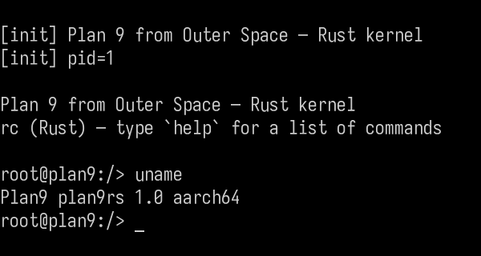
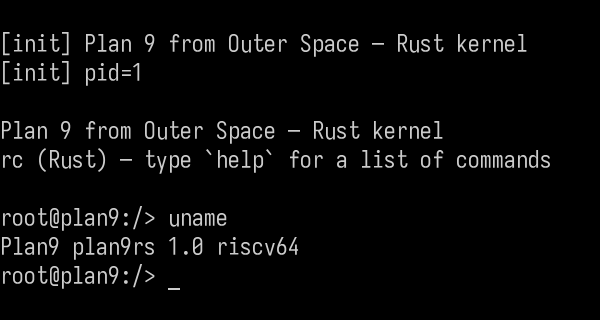

# Plan 9 Rust

A reimplementation of the Plan 9 operating system in Rust.

## Supported Architectures

Plan 9 Rust boots from a UEFI ISO into the graphical `rc` shell on four QEMU targets: x86_64 (OVMF), AArch64, RISC-V 64, and LoongArch64 (EDK2 on QEMU `virt`). i386 is not a supported boot target.

The boot menu uses UEFI Graphics Output Protocol (GOP). After exiting UEFI boot services, the kernel draws directly into the linear framebuffer handed over by the loader; it does not call GOP again. The x86_64, RISC-V, and LoongArch QEMU configurations use VGA devices. AArch64 uses `ramfb` and presents the same graphical console without relying on PC VGA text memory.

## `uname` on All Four Architectures

These screenshots show `uname` running in the graphical `rc` console after booting each UEFI ISO in QEMU. The images are cropped to the console output for readability.

<table>
  <tr>
    <td align="center"><strong>x86_64</strong><br></td>
    <td align="center"><strong>AArch64</strong><br></td>
  </tr>
  <tr>
    <td align="center"><strong>RISC-V 64</strong><br></td>
    <td align="center"><strong>LoongArch64</strong><br></td>
  </tr>
</table>

## Build and Run

### Prerequisites

- The Rust toolchain in `source/rust-toolchain.toml` and the bare-metal targets `x86_64-unknown-none`, `aarch64-unknown-none`, `riscv64imac-unknown-none-elf`, and `loongarch64-unknown-none`.
- The additional loader targets `x86_64-unknown-uefi`, `aarch64-unknown-uefi`, and `riscv64gc-unknown-none-elf`. The RISC-V kernel and user programs use the soft-float `riscv64imac` target; the loader uses `riscv64gc`. LoongArch uses `loongarch64-unknown-none` for both.
- A host C toolchain and the cross compilers `aarch64-linux-gnu-gcc`, `riscv64-linux-gnu-gcc`, and `loongarch64-linux-gnu-gcc` for the corresponding kernel entry assembly.
- GNU Make and the ISO packaging tools `xorriso`, `mkfs.vfat` (dosfstools), `mcopy` and `mmd` (mtools), and `cpio`.
- The matching `qemu-system-<arch>` binary and OVMF or EDK2 firmware. Override the firmware path with `UEFI_FW_<arch>` when it is not at a default location in `Makefile`. For split firmware images, also set `UEFI_VARS_<arch>`; the RISC-V launcher requires both images.
- Python 3 for the QEMU smoke test.

### Build the ISO

The Rust build tool in `source/build_tool` builds the kernel, init, command binaries, root filesystem, and EFI System Partition. The top-level Makefile selects the architecture and invokes the build tool or QEMU.

```bash
make ARCH=x86_64 iso
make ARCH=aarch64 iso
make ARCH=riscv64 iso
make ARCH=loongarch64 iso
make check-all
```

Each ISO is written to `build/<arch>/plan9.iso`. `make check-all` checks the kernel, init, and user commands for the four supported bare-metal targets.

### Boot in QEMU

```bash
make ARCH=x86_64 run          # Graphical window
make ARCH=aarch64 run-console # Interactive serial console
make ARCH=riscv64 run-serial  # Serial output in build/riscv64/serial.log
```

All three targets rebuild and boot the selected ISO. At the `root@plan9:/usr/root>` prompt, run `help` to list the shell built-ins and available commands. Boot the ISO to load `init` and the root filesystem along with the kernel.

### Login environment

`init` starts `rc -l`. The shell runs `/rc/lib/rcmain`, which sources `/rc/bin/termrc` and changes to the account's home. It then sources `$home/lib/profile` if present. The image includes profiles for `/usr/root` and `/usr/glenda`. Use `path=(. /bin)` to set the command search path and `env` or `ls /env` to view the current environment.

Plan 9 environment variables are files in `/env`. `rc` stores lists as NUL-terminated words. A plain `fork` shares the environment group. In `rc`, `rfork e` copies the current group into a private one, and `rfork E` replaces it with an empty group. The machine-wide environment `#ec` is readable by all users and writable by the host owner.

## QEMU Smoke Tests

```bash
for arch in x86_64 aarch64 riscv64 loongarch64; do
    make ARCH="$arch" boot-smoke mount-smoke || break
done
```

The test uses QEMU Machine Protocol (QMP) to inspect the GOP boot menu, select the verbose boot entry with the graphical keyboard, and run `uname` and `help` in the kernel's graphical console. It checks the architecture string, the complete help listing, argument handling in `echo`, and the restart of `rc` after `exit`.

The serial log is written to `build/<arch>/smoke-serial.log`. The four framebuffer captures are `smoke-menu.ppm`, `smoke-shell.ppm`, `smoke-uname.ppm`, and `smoke-help.ppm` in the same directory. The README images come from the `smoke-uname.ppm` captures.

`boot-smoke` also exercises `rc` expansion, functions, here-documents, redirection, pipeline scope, exit strings and executable `#!` scripts. Its process checks cover `/proc/<pid>/ctl` debugger stops, reads of the executable image, writes to stopped processes' private text, floating-point register inheritance and isolation, `hang`, `NSAVE` and `NRSTR`, `alarm`, and note-group delivery after the group leader exits. It checks shared exit records, orphan and `RFNOWAIT` cleanup, descriptor groups, and `ORCLOSE` cleanup of `/srv`. The single-CPU EDF tests cover admission, budget exhaustion, release, deadline ordering, `extra` and `deadlinenotes` at 10 ms resolution.

`mount-smoke` publishes connected channels through `/srv`, closes the original descriptors, and mounts a 9P2000 test server. It covers mount isolation, session reuse, `Tauth`, remote file operations, small `iounit` transfers, union directory stat records and fid cleanup. The TCP transport multiplexes opens on exclusive fids, regular-file I/O, direct directory reads and `LIST`, and path and descriptor metadata. The last explicit close on an exclusive TCP fid waits for `Rclunk` without blocking other processes; closing a duplicate does not clunk. If the closing process receives a note or exits, the in-flight clunk drains in the background. The test server reverses open and I/O replies, delays `Rclunk` until another process reads, and verifies that a killed opener's fid is not clunked before `Rflush`. It also tests shared offsets, canceled requests, partial reads, and disconnect with two outstanding readers. Path walks, opens that must clone shared fids, union directory I/O, and other control operations still wait synchronously. Non-TCP transports retain the serial path. See `build/<arch>/mount-serial.log`.

`make ARCH=<arch> rc-diff RC_REFERENCE=/path/to/plan9port/bin/rc` compares output and success/failure for 96 cases against plan9port `rc` in its classic compatibility mode (`-Y`). Cases cover subscript and expansion order, word adjacency, control-flow syntax, globbing, quoting, and redirection. The suite does not compare platform-specific status strings or prove exhaustive conformance. `/proc/<pid>/regs` and `fpregs` expose architecture-specific layouts from this port. Like the original PC port's `setkernur`, `kregs` returns a register record populated with diagnostic PC and SP, not a full register capture; the binary layout is specific to this port. `/proc/<pid>/segment` uses Plan 9's segment names, flags and hexadecimal address columns.

Noninteractive `rc` executes complete commands as it reads them, preserving multiline constructs and here-documents without buffering the entire script. Script input files use `OCEXEC`; the smoke test checks that successful `exec` closes marked channels, including duplicates, without closing ordinary channels or affecting a parent's copied descriptor group. A failed `exec` leaves marked descriptors open.

### Authentication and Crash Recovery

- `make ARCH=<arch> native-9p-smoke PLAN9PORT=/path/to/plan9port` uses real factotum, Fossil and Venti. It saves a real `Broken` process snapshot to mounted Fossil, creates a read-only filesystem snapshot, syncs, makes further unsynced changes, and kills Fossil. After restart it checks the synced data, compares both copies of the crash snapshot byte for byte, and checks new writes. It then deletes the Fossil image, restores the archive to a new image from a restarted, read-only Venti server, and verifies the restored process snapshot. The test makes no claim about the lifetime of changes not explicitly synced. By default it uses p9sk1's same-identity ticket fallback, with no independent authsrv.
- Set `PLAN9_TICKET_PORT` on that target to run the independent-authentication test instead. On a disposable Bell Labs Plan 9 VM, start `auth/keyfs -p`, use `auth/changeuser -p` to install `root` and `fossilhost` with different test passwords, then start `aux/listen1 -t tcp!*!567 /bin/auth/authsrv -d`. Forward guest TCP port 567 to a loopback-only host port. Provide the two test passwords to `make` through `PLAN9_TEST_CLIENT_PASSWORD` and `PLAN9_TEST_SERVER_PASSWORD`. The test uses separate factotum namespaces, requires the offline mount to fail, verifies that the independent server returns tickets for both identities, and reads back a file through the authenticated mount.
- `make ARCH=<arch> panic-smoke` builds a separate image that executes an illegal instruction in kernel mode and checks the trap diagnostic, kernel backtrace, terminal halt and CPU-server reboot. The regular `boot-smoke` causes a real user-mode page fault, verifies its note and `Broken` state, inspects the retained registers, and checks exit accounting and `ctl kill` cleanup while the parent continues running.
- `snap -o /tmp/crash.snap <pid>` captures a `Broken` or debugger-stopped process. The snapshot follows the Plan 9 container format with status, segments, registers, the ELF executable and readable process memory; the smoke test reads the result back and verifies original crash-stack bytes. An independent host check used Bell Labs' `readsnap` to parse captures from all four architectures and verify the ELF machine and original crash marker. This verifies the container, not the debugger ABI or native `acid`/`snapfs` operation. Use a new path: named output is created with mode `0600` and an existing file is not overwritten. Without `-o`, the snapshot goes to standard output. Do not resume or kill the target during capture, and treat output from a failed capture as incomplete.

Panic diagnostics go to the console; there is no automatic whole-machine memory dump. The boot image's root filesystem is RAM-backed. To preserve a process snapshot across a reboot, write it to a separately mounted persistent filesystem and sync that filesystem. The external Fossil/Venti test does not establish persistence of the boot root or recovery from physical power loss.

## Networking

The x86_64, AArch64, RISC-V 64 and LoongArch64 QEMU targets share two PCI drivers under `source/crates/drivers/src/network/`. `etherigbe.rs` drives Intel 82540EM and follows the device split of upstream Plan 9's `sys/src/9/pc/etherigbe.c`. `ethervirtio.rs` drives modern PCI VirtIO Ethernet. The kernel exposes Ethernet queues through `#l` and `/net/etherN`. Its `#I` device follows the conversation model in upstream `sys/src/9/ip/devip.c`.

Each bound Ethernet interface supports DHCPv4, static addresses and IPv6 SLAAC. `/net/ipifc` configures interfaces, `/net/iproute` manages longest-prefix routing and `/net/arp` lists IPv4 and IPv6 neighbors and accepts manual IPv4 entries. `iprouting 1` on an interface's `ctl` enables IPv4 and IPv6 forwarding between Ethernet interfaces. Forwarding defaults to off.

Open `/net/{tcp,udp,icmp,icmpv6,gre,rudp,ipmux,esp}/clone` to create a conversation, then use its numbered directory's `ctl`, `data`, `local`, `remote`, `status` and `err` files. TCP and UDP listeners can accept new conversations through `listen`. UDP supports the 52-byte `headers` mode. `/net/dns` resolves A and AAAA records. `/net/cs` translates dial strings using numeric addresses, DNS and local `/net/ndb` entries.

```text
ip/ipconfig
ip/ipconfig routes
ip/ipconfig dhcp
ip/ipconfig add 10.0.2.15/24 10.0.2.2
ip/ping -n 2 127.0.0.1
ip/ping -6 -n 1 ::1
ip/ping -n 1 10.0.2.2
netcat -m message 10.0.2.2 9000
netcat -u -m message 10.0.2.2 9000
netcat -u -l -H -n 2 '*' 8124
netcat -l -m reply 10.0.2.15 8123
ndb/dnsquery localhost
ndb/csquery tcp!127.0.0.1!http
snoopy -n 3 -t 0x0800 ether0
ip/traceroute -a 1 -t 10 10.0.2.2
```

`ping` and `ipconfig` are also available under their short names. `ping` accepts `-c` as an alias for `-n`. `netcat -u -l -H` echoes UDP datagrams to their senders through a single `headers` conversation and copies their payloads to stdout. `netcat -g` uses IPv4 GRE and `netcat -r` uses IPv4 RUDP with stop-and-wait retransmission. `snoopy -f 'proto=fd;data[0]=ca'` consumes matching IPv4 packets through `ipmux`. `netcat -I packet-file` sends one complete IPv4 or IPv6 packet through `ipmux` without a receive filter. Ethernet unicast output preserves the caller's IP header and recomputes the IPv4 header checksum. Socket I/O uses a bounded wait.

ESP supports manually configured unidirectional associations for IPv4 and IPv6. Connect to `address!*` for an inbound association and read `local` to obtain its SPI. Connect to `address!spi` with the peer's decimal SPI for outbound traffic. Configure `esp aes_128_cbc <32 hex digits>` and `ah aes_xcbc_mac_96 <32 hex digits>` with independently generated keys. Outbound associations also require `ivseed <32 hex digits>` with a fresh secret random value per association. Rotate the association keys when recreating a session. `netcat -E config address spi` reads these settings from a file with one control command per line and sends stdin. `netcat -E config -n 2 address '*'` receives two payloads and prints the local SPI to stderr.

Run `make ARCH=<arch> net-smoke` for the E1000 configuration or add `QEMU_NIC=virtio-net-pci,disable-legacy=on` for VirtIO. The tests exercise DHCP, ICMPv4/v6, TCP/UDP data and listeners, UDP headers with two peers, DNS/CS, GRE, RUDP retransmission, IPv4 and IPv6 ESP interoperability with OpenSSL, ARP, `ipmux` filtering and raw output, Ethernet capture, dual-stack forwarding and traceroute. `net-smoke` uses Python 3 and OpenSSL. The serial log is written to `build/<arch>/net-serial.log`.

Packet filters, RUDP and GRE currently support IPv4. IPv6 uses automatic Neighbor Discovery. Physical NICs, additional `ipifc` media, IKE, additional ESP transforms and the full Plan 9 NDB/DNS service suite are outside the tested implementation.

## Architecture and Boot Layout

`plan9_arch::hal` selects an implementation at compile time. It provides architecture-neutral entry points for boot and paging setup, address-space switching, CPU and interrupt operations, timers, the early serial console, and context switching. x86_64 also uses the GDT, IDT, port I/O, and AP startup interfaces. Kernel entry assembly and target-specific linker scripts live under `source/crates/kernel`.

| Architecture | Kernel physical base | Boot and memory layout |
| --- | --- | --- |
| x86_64 | `0x0020_0000` | The loader passes Multiboot2 information; the kernel establishes PML4 paging. |
| AArch64 | `0x4020_0000` | TTBR0/TTBR1 translation, with device mappings for low MMIO addresses. |
| RISC-V 64 | `0x8100_0000` | The kernel starts in supervisor mode and uses Sv39 paging. |
| LoongArch64 | `0x0020_0000` | Direct-mapped windows cover early kernel and device access; page tables support user processes. |

On x86_64, early boot installs the IDT and PIC with interrupts masked. The kernel enables timer and keyboard interrupts after scheduler and device initialization.

## Project Layout

```text
assets/                README screenshots
scripts/               Build launchers and QEMU smoke tests
source/
  build_tool/          Build, root filesystem, and image orchestration
  uefiboot/            UEFI loader, GOP menu, and kernel handoff
  crates/
    arch/              Architecture-specific operations and the HAL
    common/            Shared types, errors, and synchronization primitives
    kernel/            Boot entry, processes, scheduler, memory, and system calls
    init/              User-space bootstrap and rc supervision
    cmd/               Standalone bare-metal command binaries and runtime
    drivers/           PCI, storage, network, and display drivers
    fs/                Filesystems and device filesystem support
    ipc/               Interprocess communication
    net/               Network stack and protocols
    servers/           User-space services, including rio support
build/                 Local build products and QEMU output
```

## Development Status

The four supported UEFI ISO builds reach user-space `init` and `rc` in QEMU. `init` starts `/rc/bin/rc` and respawns it when it exits. The shell supports command lists, pipelines, and input and output redirection. Commands are installed under `/bin`, with `rc` also available at `/rc/bin/rc`.

The project includes synchronization primitives, a device filesystem, network and storage drivers, and host-side tests. The QEMU smoke test covers the boot-to-shell path; it does not imply that all drivers or commands are validated on physical hardware.

## License

See [LICENSE](LICENSE) for the license text included in this repository.
