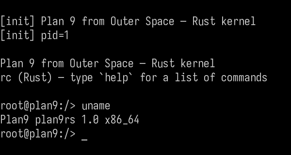
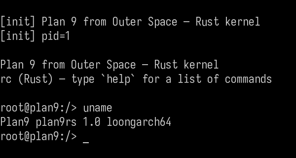

# Plan 9 Rust

A reimplementation of the Plan 9 operating system in Rust.

## Supported Architectures

Plan 9 Rust boots from a UEFI ISO into the graphical `rc` shell on four QEMU targets: x86_64 (OVMF), AArch64, RISC-V 64, and LoongArch64 (EDK2 on QEMU `virt`). i386 is not a supported boot target.

The boot menu uses UEFI Graphics Output Protocol (GOP). After exiting UEFI boot services, the kernel draws directly into the linear framebuffer handed over by the loader; it does not call GOP again. The x86_64, RISC-V, and LoongArch QEMU configurations use VGA devices. AArch64 uses `ramfb` and presents the same graphical console without relying on PC VGA text memory.

## `uname` on All Four Architectures

These screenshots show `uname` running in the graphical `rc` console after booting each UEFI ISO in QEMU. The images are cropped to the console output for readability.

<table>
  <tr>
    <td align="center"><strong>x86_64</strong><br></td>
    <td align="center"><strong>AArch64</strong><br></td>
  </tr>
  <tr>
    <td align="center"><strong>RISC-V 64</strong><br></td>
    <td align="center"><strong>LoongArch64</strong><br></td>
  </tr>
</table>

## Build and Run

### Prerequisites

- The Rust toolchain in `source/rust-toolchain.toml` and the bare-metal targets `x86_64-unknown-none`, `aarch64-unknown-none`, `riscv64imac-unknown-none-elf`, and `loongarch64-unknown-none`.
- The additional loader targets `x86_64-unknown-uefi`, `aarch64-unknown-uefi`, and `riscv64gc-unknown-none-elf`. The RISC-V kernel and user programs use the soft-float `riscv64imac` target; the loader uses `riscv64gc`. LoongArch uses `loongarch64-unknown-none` for both.
- A host C toolchain and the cross compilers `aarch64-linux-gnu-gcc`, `riscv64-linux-gnu-gcc`, and `loongarch64-linux-gnu-gcc` for the corresponding kernel entry assembly.
- GNU Make and the ISO packaging tools `xorriso`, `mkfs.vfat` (dosfstools), `mcopy` and `mmd` (mtools), and `cpio`.
- The matching `qemu-system-<arch>` binary and OVMF or EDK2 firmware. Override the firmware path with `UEFI_FW_<arch>` when it is not at a default location in `Makefile`. For split firmware images, also set `UEFI_VARS_<arch>`; the RISC-V launcher requires both images.
- Python 3 for the QEMU smoke test.

### Build the ISO

The Rust build tool in `source/build_tool` builds the kernel, init, command binaries, root filesystem, and EFI System Partition. The top-level Makefile selects the architecture and invokes the build tool or QEMU.

```bash
make ARCH=x86_64 iso
make ARCH=aarch64 iso
make ARCH=riscv64 iso
make ARCH=loongarch64 iso
make check-all
```

Each ISO is written to `build/<arch>/plan9.iso`. `make check-all` checks the kernel, init, and user commands for the four supported bare-metal targets.

### Boot in QEMU

```bash
make ARCH=x86_64 run          # Graphical window
make ARCH=aarch64 run-console # Interactive serial console
make ARCH=riscv64 run-serial  # Serial output in build/riscv64/serial.log
```

All three targets rebuild and boot the selected ISO. At the `root@plan9:/>` prompt, run `help` to list the shell built-ins and available commands. Passing a kernel ELF alone to QEMU with `-kernel` does not provide `init` and the root filesystem and is not a substitute for booting the ISO.

## QEMU Smoke Tests

```bash
for arch in x86_64 aarch64 riscv64 loongarch64; do
    make ARCH="$arch" boot-smoke || break
done
```

The test uses QEMU Machine Protocol (QMP) to inspect the GOP boot menu, select the verbose boot entry with the graphical keyboard, and run `uname` and `help` in the kernel's graphical console. It checks the architecture string, the complete help listing, argument handling in `echo`, and the restart of `rc` after `exit`.

The serial log is written to `build/<arch>/smoke-serial.log`. The four framebuffer captures are `smoke-menu.ppm`, `smoke-shell.ppm`, `smoke-uname.ppm`, and `smoke-help.ppm` in the same directory. The README images come from the `smoke-uname.ppm` captures.

## Architecture and Boot Layout

`plan9_arch::hal` selects an implementation at compile time. It provides architecture-neutral entry points for boot and paging setup, address-space switching, CPU and interrupt operations, timers, the early serial console, and context switching. x86_64 also uses the GDT, IDT, port I/O, and AP startup interfaces. Kernel entry assembly and target-specific linker scripts live under `source/crates/kernel`.

| Architecture | Kernel physical base | Boot and memory layout |
| --- | --- | --- |
| x86_64 | `0x0020_0000` | The loader passes Multiboot2 information; the kernel establishes PML4 paging. |
| AArch64 | `0x4020_0000` | TTBR0/TTBR1 translation, with device mappings for low MMIO addresses. |
| RISC-V 64 | `0x8100_0000` | The kernel starts in supervisor mode and uses Sv39 paging. |
| LoongArch64 | `0x0020_0000` | Direct-mapped windows cover early kernel and device access; page tables support user processes. |

On x86_64, early boot installs the IDT and PIC with interrupts masked. The kernel enables timer and keyboard interrupts after scheduler and device initialization.

## Project Layout

```text
assets/                README screenshots
scripts/               Build launchers and QEMU smoke tests
source/
  build_tool/          Build, root filesystem, and image orchestration
  uefiboot/            UEFI loader, GOP menu, and kernel handoff
  crates/
    arch/              Architecture-specific operations and the HAL
    common/            Shared types, errors, and synchronization primitives
    kernel/            Boot entry, processes, scheduler, memory, and system calls
    init/              User-space bootstrap and rc supervision
    cmd/               Standalone bare-metal command binaries and runtime
    drivers/           PCI, storage, network, and display drivers
    fs/                Filesystems and device filesystem support
    ipc/               Interprocess communication
    net/               Network stack and protocols
    servers/           User-space services, including rio support
build/                 Local build products and QEMU output
```

## Development Status

The four supported UEFI ISO builds reach user-space `init` and `rc` in QEMU. `init` starts `/rc/bin/rc` and respawns it when it exits. The shell supports command lists, pipelines, and input and output redirection. Commands are installed under `/bin`, with `rc` also available at `/rc/bin/rc`.

The project includes synchronization primitives, a device filesystem, network and storage drivers, and host-side tests. The QEMU smoke test covers the boot-to-shell path; it does not imply that all drivers or commands are validated on physical hardware.

## License

See [LICENSE](LICENSE) for the license text included in this repository.
